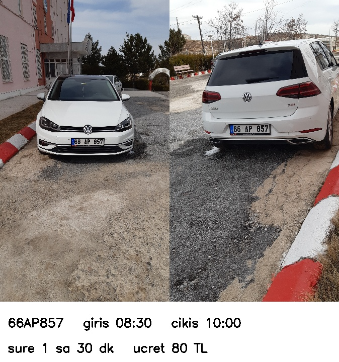

# Plaka Okuma ve Otopark Giriş-Çıkış Sistemi

Kamera görüntüsünden araç plakasını bulup okuyan (YOLO + OCR), aynı aracın giriş ve çıkışını eşleştirip kalış süresini ve ücretini hesaplayan bir sistem.



## Proje 3 aşamadan oluşuyor

1. **Plaka okuma ve OCR karşılaştırması:** plakayı YOLO ile bulup kestim, 3 farklı OCR ile okuttum, en iyisini seçtim.
2. **Kamera akışı testi:** ardışık fotoğrafları videoya çevirip sistemi akan görüntüde denedim.
3. **Otopark sistemi:** aynı aracın birden fazla fotoğrafını gruplayıp ilkini giriş, sonuncusunu çıkış kamerası olarak kullandım, süre ve ücret hesapladım.

## Dosyalar

| Dosya / klasör | Ne işe yarıyor |
|---|---|
| `plaka_yardimci.py` | ortak fonksiyonlar: görüntü ön işleme, plaka arama, fotoğraftan plaka okuma, ücret |
| `plaka_bul.py` | aşama 1: 300 fotoğrafta plakayı bulup `kirpintilar/` klasörüne kesiyor |
| `ocr_karsilastirma.py` | aşama 1: Tesseract, EasyOCR ve fast-plate-ocr karşılaştırması |
| `etiketler.csv` | elle etiketlenen 50 gerçek plaka |
| `video_olustur.py` | aşama 2: ardışık 300 fotoğrafı `veri/giris_kamerasi.mp4` videosuna çeviriyor |
| `plaka_okuma.py` | aşama 2: videoda plaka bulup okuma |
| `arac_grupla.py` | aşama 3: 1955 fotoğrafı okuyup aynı aracın fotoğraflarını grupluyor |
| `otopark.py` | aşama 3: elle yazılmış bir günlük senaryo, giriş-çıkış eşleştirme, süre, ücret, çıkış kartları |
| `license-plate-finetune-v1n.pt` | hazır YOLO11 plaka bulma modeli |
| `requirements.txt` | gerekli kütüphaneler |
| `veri/`, `sonuclar/`, `ekran_goruntuleri/` | veri, csv sonuçları ve demo videosu, görseller |

## Kurulum

```
pip install -r requirements.txt
```

- Tesseract ayrıca kurulmalı (Windows için UB Mannheim kurucusu), kodda yolu `C:\Program Files\Tesseract-OCR\tesseract.exe`.
- EasyOCR `opencv-python-headless` kuruyor, bu `cv2.imshow`'u bozabiliyor. Sonrasında:
  ```
  pip uninstall -y opencv-python-headless
  pip install --force-reinstall --no-deps opencv-python==4.11.0.86
  ```

## Çalıştırma sırası

```
python plaka_bul.py
python ocr_karsilastirma.py
python video_olustur.py
python plaka_okuma.py
python arac_grupla.py
python otopark.py
```

## Veri

- **Turkish License Plate Dataset** (Kaggle, smaildurcan): Türkiye'de çekilmiş ~1955 araç fotoğrafı, plaka konumları etiketli, plaka yazısı yok.
- **Synthetic Turkish License Plates** (Kaggle, tustunkok): 100.000 sentetik türk plakası, dosya adı plakanın kendisi.

Veri setleri boyutları büyük olduğu için repoya eklenmedi. İkisini de Kaggle'dan indirip şu şekilde yerleştirmek gerekiyor:

```
veri/
├── turk_plaka/images/                 # 1.jpg, 2.jpg, ...
└── sentetik_turk_plaka/license-plates/  # 01-A-2808.png, ...
```

`kirpintilar/` klasörü `plaka_bul.py` çalışınca oluşuyor. `etiketler.csv` bu kırpıntılara göre hazırlandığı için önce `plaka_bul.py` çalıştırılmalı.

## Sonuçlar

### Plaka bulma

İlk 300 fotoğrafın 294'ünde plaka bulundu (%98).

### OCR karşılaştırması (doğru okunan plaka oranı)

| Model | 50 gerçek plaka | 300 sentetik plaka | Ortalama süre |
|---|---|---|---|
| Tesseract | %16 (ön işlemeli %20) | %85,3 (ön işlemeli %82) | ~185 ms |
| EasyOCR | %78 (ön işlemeli %74) | %95,7 (ön işlemeli %95,7) | ~675 ms |
| **fast-plate-ocr** | **%100** (ön işlemeli %92) | %95,7 (ön işlemeli %96) | **~16 ms** |

Sentetik plakalar 100.000 plakadan her 333.'sü alınarak seçildi. Tablo `sonuclar/ocr_ozet.xlsx` dosyasında.

OCR modelleri plakanın çerçevesindeki galeri adını ve "TR" yazısını da okuyabiliyor (örnek: `I166AP857KARACAYOZOAT`). `plaka_ara` fonksiyonu okunan metnin içinde plaka kalıbına uyan kısmı arayıp sadece plakayı alıyor. Ana sistemde en doğru ve en hızlı olan fast-plate-ocr kullanıldı.

### Kamera akışı testi

300 saniyelik videoda 77 farklı plaka okundu. Okunan plakalar ve kaç karede okundukları `sonuclar/okunan_plakalar.csv`, video `sonuclar/sistem_demo.mp4`.

### Otopark sistemi

1955 fotoğrafta 1298 farklı plaka okundu, aynı plakalı fotoğraflar gruplandı (`sonuclar/arac_gruplari.csv`). Bu gruplardan 5 araç seçilip ilk fotoğrafı giriş, son fotoğrafı çıkış olacak şekilde bir günlük senaryo yazıldı:

| Plaka | Giriş | Çıkış | Süre | Ücret |
|---|---|---|---|---|
| 79DR707 | 07:45 | 08:20 | 35 dk | 50 TL |
| 66AP857 | 08:30 | 10:00 | 90 dk | 80 TL |
| 06TIH40 | 09:00 | 18:00 | 540 dk | 300 TL |
| 20R7720 | 13:00 | 15:30 | 150 dk | 150 TL |
| 11DR660 | 14:00 | 19:20 | 320 dk | 210 TL |

Bütün çıkışlar doğru eşleşti, toplam gelir 790 TL. Kayıtlar `sonuclar/otopark_kayitlari.csv`, çıkış kartları `ekran_goruntuleri/cikis_kartlari/`.

Tarife: 1 saate kadar 50 TL, 2 saate kadar 80 TL, 4 saate kadar 150 TL, sonrasında başlayan her saat için +30 TL.

## Varsayımlar

- Fotoğraflarda giriş-çıkış saati olmadığı için saatler elle yazıldı. Plakalar ise her seferinde fotoğraftan gerçekten okunuyor.
- Aynı plaka sadece birebir aynı okunursa aynı araç sayılıyor. Bir harfi yanlış okunan fotoğraf ayrı araç olarak görünüyor.
- Kamera akışı testinde veri setindeki ardışık fotoğraflardan oluşturulan video kullanıldı. Kod videoyu `cv2.VideoCapture` ile okuduğu için gerçek bir kamera videosuyla da çalışır.

## Eksikler ve geliştirilebilecekler

- Plaka bulma modeli hazır model, Türk plakalarıyla yeniden eğitilmedi.
- Gerçek bir otopark kamerası videosuyla test edilmedi.
- Kayıtlar csv'ye yazılıyor, veritabanı ve arayüz yok.

## Kullanılan kaynaklar

- YOLO11 plaka modeli: huggingface.co/morsetechlab/yolov11-license-plate-detection (AGPL-3.0)
- fast-plate-ocr: github.com/ankandrew/fast-plate-ocr (MIT)
- Tesseract OCR, EasyOCR, Ultralytics, OpenCV

## Lisans

Projede AGPL-3.0 lisanslı Ultralytics kütüphanesi ve plaka modeli kullanıldığı için proje de AGPL-3.0 ile lisanslandı.
